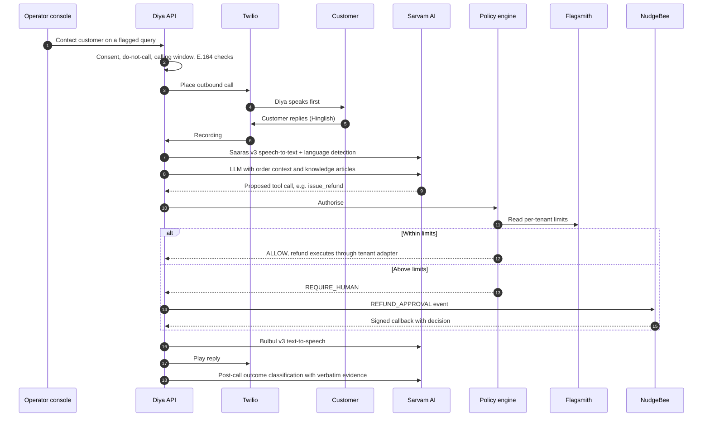
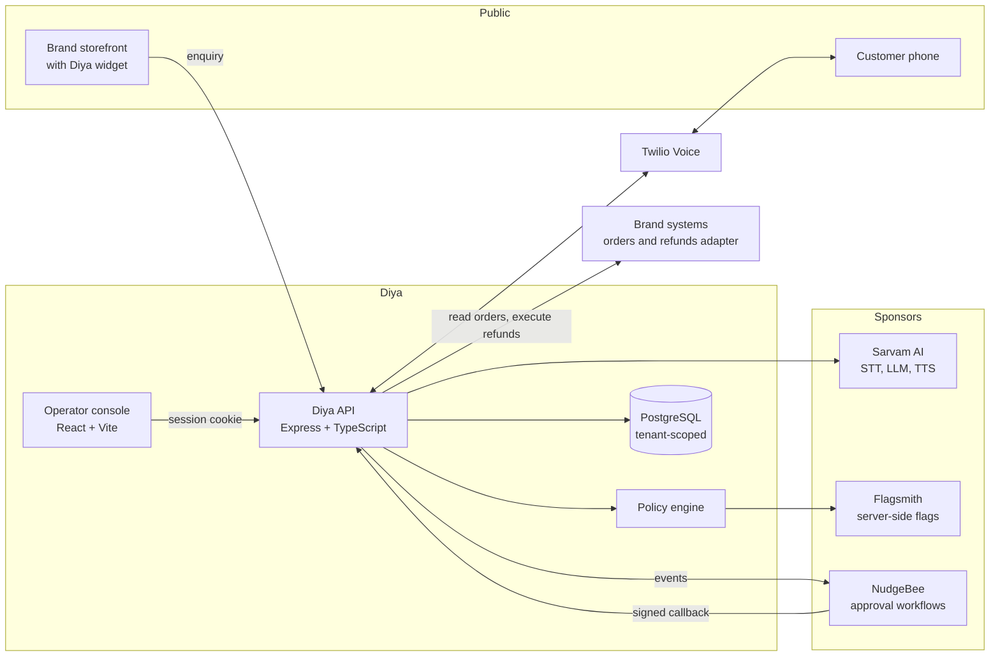

# Diya

**AI customer support for the festive rush that is allowed to resolve issues, refunds included, safely and in the customer's own language.**

Built by Team Tech Phantoms for Festive Hacks, WeAreDevelopers Conference India, Bengaluru, 25 November 2026.

| | |
|---|---|
| Sponsor stack | Sarvam AI (voice and reasoning), Flagsmith (autonomy control), NudgeBee (human approval) |
| Web stack | TypeScript, Express 5, Prisma 6, PostgreSQL 16, React 19, Vite, Tailwind CSS 4 |
| Telephony | Twilio Programmable Voice |
| Team | Subramanya Rao (lead), Likhith Raju P, Jithendra V, Avez Qureshi |

---

## Table of contents

1. [The problem](#the-problem)
2. [What Diya does](#what-diya-does)
3. [How a call works](#how-a-call-works)
4. [How the sponsor tools are used](#how-the-sponsor-tools-are-used)
5. [Architecture](#architecture)
6. [Security and trust](#security-and-trust)
7. [Getting started](#getting-started)
8. [Configuration reference](#configuration-reference)
9. [Running the demo](#running-the-demo)
10. [Testing](#testing)
11. [Repository layout](#repository-layout)
12. [Roadmap](#roadmap)

---

## The problem

From Diwali to New Year, Indian D2C and quick-commerce brands see four to five times their normal order volume, and the support queue cannot keep up. Most of the overflow is a handful of repetitive issues: *where is my order*, *the wrong item arrived*, *I need a refund before the function tonight*. Much of it arrives as code-mixed Hinglish voice, not tidy English chat.

Brands respond by hiring temporary agents or adding an FAQ chatbot. Neither resolves anything, because what the customer usually wants is a refund or a replacement, and no one lets an AI move money.

**Diya's thesis: anyone can build a chatbot, but very few ship one that is trusted to touch money.** The policy, feature-flag and approval layers are what make AI autonomy deployable.

## What Diya does

Diya is a multi-tenant, AI-native support platform for festive-season commerce.

- **Proactive outbound calls.** A brand flags orders that are going wrong, and Diya calls the customer first over a real phone line, in their own language, with consent and calling-window checks enforced before any dial.
- **Indic-first voice.** Sarvam Saaras v3 transcribes code-mixed Hinglish, a Sarvam LLM reasons over live order context and the brand's knowledge base, and Sarvam Bulbul v3 replies in natural Indian speech.
- **Real resolution, not deflection.** The agent can issue refunds and cite knowledge-base articles, but only through structured tool calls that a deterministic policy engine must authorise.
- **A live autonomy dial.** Refund ceilings, a kill switch and a festive surge mode are Flagsmith flags, targeted per brand and changeable without a redeploy.
- **Human-in-the-loop.** Anything above the brand's limit is routed to a NudgeBee approval workflow. When a human approves, NudgeBee calls back and the refund executes.
- **Evidence-backed outcomes.** Every call is classified as Resolved, Ongoing or Human Review, and the classifier must quote the customer verbatim as evidence.
- **Embeddable enquiry widget.** One script tag adds a consent-aware enquiry widget to any storefront. Enquiries land instantly in the operator console.
- **Operator console.** A single inbox for website and outbound queries, call transcripts, an audit trail of every agent action, pending approvals, a knowledge-base editor, workflow settings and member management.

## How a call works



1. **Dial.** An operator starts a call on a flagged query. Diya verifies consent, do-not-call status, the India calling window and the phone number format before dialling.
2. **Listen.** Twilio records each customer turn. Sarvam Saaras v3 transcribes it and detects the language, including code-mixed Hinglish.
3. **Reason.** The Sarvam LLM reasons over the order context and retrieved knowledge-base articles and proposes a structured tool call: `issue_refund`, `cite_knowledge_article` or `end_call`.
4. **Authorise.** The model has no direct write access. The policy engine applies hard rules in code (the order must belong to this tenant and ticket, be under seven days old and not already refunded, and the amount must not exceed the order value), then applies the Flagsmith limits and returns `ALLOW`, `DENY` or `REQUIRE_HUMAN`.
5. **Act or escalate.** `ALLOW` executes the refund through the brand's own system. `REQUIRE_HUMAN` triggers a NudgeBee approval, and the agent tells the customer the request is being reviewed.
6. **Speak.** Sarvam Bulbul v3 renders the reply as speech, played back on the call.
7. **Classify.** When the call ends, the outcome classifier labels it and must quote the customer's own words as evidence. A call cannot be marked resolved unless the customer explicitly confirmed it.

## How the sponsor tools are used

All three sponsor tools sit on the critical path of every call. Together they answer three questions: how the customer reaches us (Sarvam), what the AI is allowed to do on its own (Flagsmith), and what happens when it is not (NudgeBee).

### Sarvam AI: the voice and reasoning stack

Source: [`web/server/src/sarvam/`](web/server/src/sarvam/)

| Capability | Model | Role in Diya |
|---|---|---|
| Speech-to-text | Saaras v3 | Transcribes each customer turn and detects the spoken language, including code-mixed Hinglish |
| Reasoning | Sarvam LLM through the OpenAI-compatible API | Agent reasoning with structured tool calling; also powers the post-call outcome classifier |
| Text-to-speech | Bulbul v3 | Natural Indian-language replies played to the customer over Twilio |

Because the Sarvam LLM endpoint is OpenAI-compatible, tool calling works with the standard OpenAI SDK by changing only the base URL. Browser push-to-talk and real phone calls share the same Sarvam pipeline.

### Flagsmith: the AI's autonomy dial

Source: [`web/server/src/flags/`](web/server/src/flags/), [`web/server/src/policy/`](web/server/src/policy/)

Flags feed the policy engine, never the prompt, and are evaluated server-side only through the Flagsmith Node SDK. Each brand is a Flagsmith identity (`tenant:<slug>`), so every tenant gets its own risk appetite on the same agent and the same deployment.

| Flag | Purpose |
|---|---|
| `ai_agent_enabled` | Global or per-tenant kill switch for the agent |
| `auto_refund_limit_inr` | Refunds up to this amount execute autonomously (default 2,000 INR) |
| `human_approval_above_inr` | Above this amount a human always approves (default 5,000 INR) |
| `festive_surge_mode` | Raises the autonomous ceiling by 1.5x during peaks, never above the human-approval ceiling |
| `enabled_languages` | Per-tenant language rollout |
| `agent_prompt_variant` | A/B testing of agent personas |

Engineering details:

- **Typed accessors.** Every flag key is defined in one file; there are no magic strings elsewhere.
- **Fail-safe defaults.** A default flag handler returns conservative values if Flagsmith is unreachable, so an outage degrades predictably.
- **Short cache.** A five-second cache keeps the call path fast while flag changes still take effect within seconds.
- **Flag snapshot auditing.** Every agent action stores the exact flag values it was decided against, so any past decision can be explained later.
- **Hard rules are never flag-controlled.** Tenant ownership, order age, double-refund protection and the order-value cap live in code. Flags only move the ceiling within safe bounds.

### NudgeBee: human approval and escalation

Source: [`web/server/src/nudgebee/`](web/server/src/nudgebee/), [`web/server/src/routes/approvals.ts`](web/server/src/routes/approvals.ts), [`web/server/src/approvals/decide.ts`](web/server/src/approvals/decide.ts). Workflow contract: [`NUDGEBEE-SETUP.md`](NUDGEBEE-SETUP.md).

Diya uses NudgeBee's Automation Webhook, Approval task and HTTP request chain as its human-in-the-loop backbone.

1. **`REFUND_APPROVAL` event.** When the policy engine returns `REQUIRE_HUMAN`, Diya posts a structured payload (approval ID, tenant, order, amount, customer, reason) to the NudgeBee workflow webhook.
2. **Approval task.** The approver sees a readable request, for example *Refund 6,800 INR on ORD-1041 for Asha Rao?*, and approves or rejects it.
3. **Authenticated callback.** NudgeBee calls `POST /api/approvals/callback` with the decision. The shared secret is stored as a NudgeBee workflow Secret, sent in a header and compared in constant time.
4. **One place where money moves.** `approvals/decide.ts` applies decisions idempotently with tenant scoping, so duplicate callbacks are no-ops, and records every decision in the audit trail.
5. **`HUMAN_REVIEW` event.** Calls the classifier flags for review are sent to NudgeBee with the verbatim evidence and transcript link.

If a NudgeBee run times out, an operator can decide from the console through the same idempotent decision path. The console's Approval workflows page shows configuration status, a trigger log and a test-event button.

## Architecture



| Component | Location | Responsibility |
|---|---|---|
| Diya API | `web/server` | Calls, agent orchestration, policy, approvals, knowledge retrieval, widget intake, auth |
| Operator console | `web/client` | Queries, tickets, call transcripts, knowledge base, widget and workflow settings, members |
| Embeddable widget | `web/server/public/widget.js` | Consent-aware enquiry form served to brand storefronts |
| Storefront demo | `web/storefront-demo` | A festive storefront used to demonstrate the widget |
| Tenant adapters | `web/server/src/adapters` | Brand integration seam; the mock adapter is used when no webhook is configured |

**No data copying.** A brand exposes two endpoints, one to read orders and one to issue refunds, and Diya reads on demand. Customer data is not synchronised into Diya, so a brand can switch Diya off without losing anything.

## Security and trust

- **Tenant isolation.** Every tenant-scoped table carries a `tenantId`, and the data layer refuses tenant-scoped operations that omit a tenant predicate. Cross-tenant identifiers resolve as not found.
- **The LLM proposes, the policy engine disposes.** The model cannot write to any system directly. Every action is a structured proposal checked by unit-tested code.
- **Least privilege for automation.** The approval callback accepts only a decision for a known pending approval in the matching tenant, authenticated by a shared secret.
- **No secrets in code.** All keys, tokens and webhook URLs come from environment variables or a secret manager. The NudgeBee webhook URL is treated as a credential and is never logged or shown in full in the UI.
- **Consent first.** Website enquiries do not imply consent to a phone call. Outbound calling requires an explicit opt-in or a recorded consent source, honours do-not-call immediately, and runs only within the configured India calling window.
- **Fail closed.** Outbound calling is disabled unless `OUTBOUND_CALLING_ENABLED=true`. Flag outages fall back to conservative defaults.
- **Invitation-only access.** Operators join by single-use invitation. Sessions are cookie-based with idle and absolute expiry, sign-in is throttled, and authentication events are audited.
- **Full audit trail.** Every agent action records the tool, arguments, policy decision, flag snapshot and result.

## Getting started

### Prerequisites

- Node.js 20 or later and npm
- Docker (for the local PostgreSQL container)
- Optional, for live calls and sponsor integrations: Sarvam AI, Flagsmith, NudgeBee and Twilio accounts, plus a public HTTPS tunnel for Twilio webhooks

### 1. Clone and install

```bash
git clone https://github.com/avezqureshi15/tech-phantoms.git
cd tech-phantoms
npm install
npm --prefix web/server install
npm --prefix web/client install
```

### 2. Start PostgreSQL

The compose file reads the database password from the environment. Choose your own value.

```bash
export DIYA_POSTGRES_PASSWORD='<choose-a-local-password>'
docker compose up -d
```

This starts PostgreSQL 16 on `127.0.0.1:5434`, bound to localhost only.

### 3. Configure environment

```bash
cp web/server/.env.example web/server/.env.local
cp web/client/.env.example web/client/.env.local
```

In `web/server/.env.local`, set at minimum:

- `DATABASE_URL`: a PostgreSQL connection string for the `diya` database on port 5434, using the password from step 2
- `BOOTSTRAP_ADMIN_EMAIL`: the email address of the first platform administrator

In `web/client/.env.local`, set `VITE_API_BASE_URL=http://localhost:4002`.

`.env.local` files are git-ignored. Never commit real keys or phone numbers.

### 4. Create the schema and seed demo data

```bash
npm --prefix web/server run prisma:generate
npm --prefix web/server run prisma:push
npm --prefix web/server run prisma:seed
```

The seed resets demo data and creates two demo tenants (`festive-mart` and `sweet-co`) with customers, orders, products, knowledge articles, sample call histories and the demo widget installation.

### 5. Create the first administrator

```bash
npm --prefix web/server run bootstrap:admin
```

The command prints a single-use invitation link. Open it, set a password, and sign in. To create a tenant administrator invitation for each seeded workspace instead, run `npm --prefix web/server run bootstrap:demo`.

### 6. Run everything

```bash
npm run dev
```

| Application | URL |
|---|---|
| Operator console | http://localhost:5173 |
| Diya API | http://localhost:4002 (health check at `/api/health`) |
| Storefront demo with widget | http://localhost:5174 |

The console, the widget flow, knowledge retrieval and the policy engine all work without sponsor keys: the mock tenant adapter serves orders and refunds, and Flagsmith falls back to its safe defaults. Live phone calls need the Sarvam, Twilio and public URL settings below.

## Configuration reference

All server settings live in `web/server/.env.local`. See [`web/server/.env.example`](web/server/.env.example) for the full list with comments.

| Variable | Required for | Notes |
|---|---|---|
| `DATABASE_URL` | Everything | PostgreSQL connection string |
| `SARVAM_API_KEY` | Voice and agent reasoning | Saaras v3, Bulbul v3 and the Sarvam LLM |
| `FLAGSMITH_SERVER_KEY` | Live flag control | Server-side SDK key only, never the client key |
| `NUDGEBEE_WEBHOOK_URL` | Human approvals | Treat as a credential; HTTPS only |
| `APPROVAL_CALLBACK_SECRET` | Human approvals | Stored in NudgeBee as a workflow Secret |
| `TWILIO_ACCOUNT_SID`, `TWILIO_AUTH_TOKEN`, `TWILIO_PHONE_NUMBER` | Phone calls | Twilio Programmable Voice |
| `PUBLIC_BASE_URL` | Phone calls and callbacks | Public HTTPS URL of the API (tunnel or deployment) |
| `OUTBOUND_CALLING_ENABLED` | Phone calls | Defaults to `false`; calling is fail-closed |
| `CALL_WINDOW_START`, `CALL_WINDOW_END` | Phone calls | India calling window, default 09:00 to 21:00 |
| `MAX_TURNS_PER_CALL`, `MAX_CALL_DURATION_SEC` | Phone calls | Per-call safety limits |
| `CALLABLE_QUERY_CATEGORIES` | Phone calls | Categories eligible for outbound follow-up |
| `CLIENT_ORIGIN` | Local development | Allowed browser origins for the console and storefront |

Production deployment (Docker Compose behind Caddy, secrets fetched from a secret manager at boot, scheduled PostgreSQL backups) is described in [`DEPLOY-PLAN.md`](DEPLOY-PLAN.md), with configuration in [`deploy/`](deploy/).

## Running the demo

1. Open the storefront at http://localhost:5174 and select **Ask us anything**.
2. Submit a question, for example in Hinglish: *Hand-beaten Brass Diyas ka pair Diwali se pehle Pune deliver ho jayega?* Tick the contact consent box. Tick the call opt-in only if you want the query to become callable.
3. In the console, open **Queries** for the Festive Mart workspace. The enquiry appears at the top of the inbox.
4. Open a resolved query, such as the Terracotta Diya Set enquiry, and then the call, to see the full Hinglish transcript and the evidence-backed outcome.
5. Open **Approval workflows** to see the NudgeBee integration status and trigger log, and **Knowledge** to see the articles that ground the agent's answers.
6. With sponsor keys configured, lower `auto_refund_limit_inr` in Flagsmith and repeat a refund request. The same request changes from `ALLOW` to `REQUIRE_HUMAN` and triggers a NudgeBee approval, with no redeploy.

## Testing

```bash
npm --prefix web/server test
npm --prefix web/server run test:enquiry-integration
npm --prefix web/server run lint
npm --prefix web/client run lint
```

The unit suite covers the policy engine, call guards and error handling, authentication, tenant guarding, knowledge retrieval, NudgeBee triggers and the public widget API. The integration test exercises the widget-to-inbox flow against a real database.

## Repository layout

```text
.
├── web/
│   ├── server/              Express API, agent, policy engine, Prisma schema
│   │   ├── prisma/          Schema and seed scripts
│   │   ├── public/          Embeddable widget (widget.js)
│   │   ├── scripts/         Admin bootstrap and maintenance scripts
│   │   └── src/
│   │       ├── adapters/    Tenant integration seam (mock and webhook)
│   │       ├── agent/       LLM orchestration, prompts and tool definitions
│   │       ├── approvals/   Idempotent approval decisions
│   │       ├── auth/        Invitations, sessions, passwords, audit
│   │       ├── call/        Twilio call flow, guards and recording
│   │       ├── flags/       Flagsmith client and typed flag keys
│   │       ├── knowledge/   Knowledge-base retrieval
│   │       ├── nudgebee/    NudgeBee workflow triggers
│   │       ├── outcome/     Post-call outcome classification
│   │       ├── policy/      Deterministic authorisation rules
│   │       ├── routes/      HTTP routes
│   │       └── sarvam/      Sarvam STT, TTS and LLM clients
│   ├── client/              React operator console
│   └── storefront-demo/     Festive storefront for the widget demo
├── mobile/                  Companion festive-planning app (FastAPI backend, Expo frontend)
├── deploy/                  Production deployment configuration
├── compose.yaml             Local PostgreSQL
├── NUDGEBEE-SETUP.md        NudgeBee workflow contract
└── DEPLOY-PLAN.md           Deployment guide
```

## Roadmap

- Move telephony onto Sarvam Samvaad so the entire call stays within the Sarvam stack.
- Streaming speech-to-text and text-to-speech to reduce turn latency.
- Approver routing by amount and escalation on approval timeout.
- Additional Indian languages rolled out per tenant through `enabled_languages`.
- A/B testing of agent personas through `agent_prompt_variant`, measured against resolution rate.
- Self-serve tenant onboarding with production adapters for common commerce platforms.

---

Built at Festive Hacks 2026 with Sarvam AI, Flagsmith and NudgeBee.
