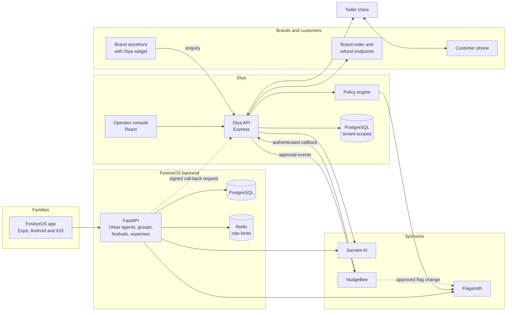

# Tech Phantoms: FestiveOS and Diya

**One festive season, both sides of the counter.** FestiveOS helps Indian families plan, celebrate and budget their festivals. Diya helps the brands they buy from resolve the festive support rush, safely and in the customer's own language.

Built by Team Tech Phantoms for Festive Hacks, WeAreDevelopers Conference India, Bengaluru, 25 November 2026.

| | FestiveOS | Diya |
|---|---|---|
| Who it serves | Families, friends and office groups celebrating festivals | D2C and quick-commerce brands during peak season |
| Form factor | Android and iOS app | Operator console, phone agent and embeddable website widget |
| Sarvam AI | Voice assistant (Saaras v4, Bulbul v3), Sarvam Translate, document and receipt reading | Phone-call speech-to-text (Saaras v3), agent reasoning (Sarvam LLM), speech (Bulbul v3) |
| Flagsmith | Server-enforced kill switches and remote config for every paid or risky feature | Per-brand refund limits, agent kill switch and festive surge mode |
| NudgeBee | Approval-gated incident runbooks that switch features off through Flagsmith | Human approval for refunds above the brand's limit, and review of flagged calls |
| Stack | Python 3.12, FastAPI, SQLAlchemy 2, PostgreSQL, Redis; Expo SDK 58, React Native, TypeScript | TypeScript, Express 5, Prisma 6, PostgreSQL 16, React 19, Vite, Tailwind CSS 4, Twilio Voice |

**Team:** Subramanya Rao (lead), Likhith Raju P, Jithendra V, Avez Qureshi.

---

## Table of contents

1. [The problem](#the-problem)
2. [The solution at a glance](#the-solution-at-a-glance)
3. [FestiveOS: the family festival app](#festiveos-the-family-festival-app)
4. [Diya: AI support for festive commerce](#diya-ai-support-for-festive-commerce)
5. [How the sponsor tools are used](#how-the-sponsor-tools-are-used)
6. [Architecture](#architecture)
7. [Security and trust](#security-and-trust)
8. [Getting started](#getting-started)
9. [Running the demo](#running-the-demo)
10. [Testing](#testing)
11. [Repository layout](#repository-layout)
12. [Roadmap](#roadmap)

---

## The problem

From Diwali to New Year, India celebrates, hosts, shops and gives more than at any other time of year. That creates two problems that meet in the middle.

**For families**, the festive season is a coordination problem. Which day is the festival this year in our city, and what is the muhurat? Who is coming to dinner, how much food do we need, and do we have enough plates? Who paid for the sweets, and who owes whom? Households often follow more than one faith and calendar, elders want to take part by voice and in their own language, and the planning lives in a family group chat.

**For brands**, the festive season is a support problem. D2C and quick-commerce brands see four to five times their normal order volume, and the support queue cannot keep up. Most of the overflow is a handful of repetitive issues: *where is my order*, *the wrong item arrived*, *I need a refund before the function tonight*. Much of it is code-mixed Hinglish voice. FAQ chatbots deflect, because what the customer wants is a refund or a replacement, and no one lets an AI move money.

## The solution at a glance

| Product | Promise |
|---|---|
| **FestiveOS** | A festival operating system for the family group: calendars and panchang for every faith, traditions and checklists, shared expenses, and Utsav, an assistant you can talk to in your own language that plans with real numbers instead of guesses |
| **Diya** | A support agent that calls the customer first, speaks their language, and is allowed to resolve the issue, refunds included, inside limits each brand controls live, with a human approving anything above them |

The two products are designed to connect. A FestiveOS user can ask for a call back from the app; the mobile backend sends a minimal, consented, HMAC-signed request to Diya, whose agent then phones the person in their language. The mobile side of this link is implemented; the Diya endpoint that receives it is the next integration step (see [Roadmap](#roadmap)).

Both products share one design principle: **the AI proposes, deterministic code disposes.** In FestiveOS the model never does arithmetic and never writes data without a confirmation card the person approves. In Diya the model never moves money without a policy engine, live Flagsmith limits and, above those limits, a human in NudgeBee.

---

## FestiveOS: the family festival app

Source: [`mobile/backend`](mobile/backend) (FastAPI) and [`mobile/frontend`](mobile/frontend) (Expo).

### Features

- **Groups.** A person can belong to any number of groups (household, friends, office), each with its own members, roles, festivals, expenses and conversations. Membership and admin rules are enforced by the API, not just the app.
- **Festivals for every faith.** Calendars and observances for Hindu, Buddhist, Jain, Sikh, Christian and Muslim traditions, each on its own calendar rather than bolted onto another. Hindu households get a proper panchang for their city.
- **Traditions and checklists.** Each festival carries the group's own traditions, their history across years, and a checklist of what needs doing.
- **Shared expenses.** Track who paid for what during the festival and settle up within the group. Receipts can be scanned instead of typed.
- **Utsav, the AI assistant.** Plain-language planning backed by the group's own data. Say *I'm hosting 3 people for dinner* and Utsav asks for what is missing on a single question card, computes food, raw shopping, seating and plates with deterministic code, and suggests safe improvisations (*jugaad*) when something falls short.
- **Voice in your language.** Talk to Utsav and hear it reply, powered by Sarvam speech-to-text, translation and text-to-speech.
- **Elder mode and recitation practice.** A slower, voice-first conversation for elders, and line-by-line practice of prayers and sacred texts with checks on what was heard.
- **Devotional audio and event search.** A curated audio catalog, and live search for festival events nearby.
- **Call-back support.** Request a phone call back from the support team, with explicit consent and only the minimum data shared.

### How Utsav works

Utsav is a multi-agent system. An orchestrator, Sutradhar, decides which specialist speaks next: a requirements agent gathers facts, a planner calculates the plan, and a jugaad agent explains safe improvisations.

```text
person: "I'm hosting 3 people for dinner"
  Sutradhar     -> handoff(requirements)
  requirements  -> get_household_context, list_inventory
                -> ask_user  ----------->  QUESTION CARD  (adults, elders, diet, in one card)
  planner       -> calculate_hosting  -->  HOSTING PLAN CARD (food, shopping, seats, plates)
  jugaad        -> jugaad_options     -->  safe improvisations, only if something falls short
```

The design rules, each covered by tests:

- **The model never does arithmetic.** Quantities come from `ai/hosting.py`, not from the model.
- **The model never writes data.** A proposed action becomes a confirmation card built from validated parameters, and the write runs only after approval, as the approving person, through the normal permission checks.
- **Cards are validated both ways**, so a hallucinated option or a hostile client cannot get through.
- **Per-agent tool allow-lists** are enforced at call time, whatever the prompt says.
- **Cost and abuse controls.** Hourly and daily per-user AI budgets, a cap on model calls per turn, and a cap on concurrent turns per process.
- **Privacy.** Message content is never logged, and conversations are private to their owner.

Design notes: [`mobile/backend/docs/ai.md`](mobile/backend/docs/ai.md), [`religions-and-calendars.md`](mobile/backend/docs/religions-and-calendars.md), [`groups-and-expenses.md`](mobile/backend/docs/groups-and-expenses.md).

---

## Diya: AI support for festive commerce

Source: [`web/server`](web/server) (Express API) and [`web/client`](web/client) (operator console).

### Features

- **Proactive outbound calls.** A brand flags orders that are going wrong, and Diya calls the customer first over a real phone line, with consent, do-not-call and calling-window checks enforced before any dial.
- **Indic-first voice.** Sarvam Saaras v3 transcribes code-mixed Hinglish, a Sarvam LLM reasons over live order context and the brand's knowledge base, and Sarvam Bulbul v3 replies in natural Indian speech.
- **Real resolution.** The agent can issue refunds and cite knowledge-base articles, only through structured tool calls that a deterministic policy engine authorises.
- **A live autonomy dial.** Refund ceilings, a kill switch and a festive surge mode are Flagsmith flags, targeted per brand and changeable without a redeploy.
- **Human-in-the-loop.** Anything above the brand's limit goes to a NudgeBee approval workflow; when a human approves, NudgeBee calls back and the refund executes.
- **Evidence-backed outcomes.** Every call is classified as Resolved, Ongoing or Human Review, and the classifier must quote the customer verbatim.
- **Embeddable enquiry widget.** One script tag adds a consent-aware enquiry form to any storefront; enquiries land instantly in the console.
- **Operator console.** One inbox for website and outbound queries, call transcripts, an audit trail of every agent action, approvals, a knowledge-base editor, workflow settings and member management.

### How a call works


1. **Dial.** Diya verifies consent, do-not-call status, the India calling window and the number format before dialling.
2. **Listen.** Twilio records each customer turn; Saaras v3 transcribes it and detects the language.
3. **Reason.** The Sarvam LLM proposes a structured tool call: `issue_refund`, `cite_knowledge_article` or `end_call`.
4. **Authorise.** Hard rules in code (tenant and ticket ownership, order under seven days old, not already refunded, amount within order value), then Flagsmith limits, produce `ALLOW`, `DENY` or `REQUIRE_HUMAN`.
5. **Act or escalate.** `ALLOW` executes through the brand's system; `REQUIRE_HUMAN` triggers a NudgeBee approval.
6. **Speak.** Bulbul v3 renders the reply, played back on the call.
7. **Classify.** A call cannot be marked resolved unless the customer explicitly confirmed it.

**No data copying.** A brand exposes two endpoints, one to read orders and one to issue refunds, and Diya reads on demand. A brand can switch Diya off without losing anything.

---

## How the sponsor tools are used

All three sponsor tools sit on the critical path of both products.

### Sarvam AI

| Product | Capability | Model | Role |
|---|---|---|---|
| FestiveOS | Speech-to-text | Saaras v4 | Talk to Utsav; check recitation practice |
| FestiveOS | Text-to-speech | Bulbul v3 | Utsav speaks its replies, including elder mode |
| FestiveOS | Translation | Sarvam Translate v1 | Bridge the family's language and the assistant's |
| FestiveOS | Document intelligence | Sarvam document parsing | Read receipts and uploaded documents |
| Diya | Speech-to-text | Saaras v3 | Transcribe each phone turn and detect code-mixed Hinglish |
| Diya | Reasoning | Sarvam LLM (OpenAI-compatible API) | Agent tool calling and the post-call outcome classifier |
| Diya | Text-to-speech | Bulbul v3 | Natural Indian speech played over Twilio |

Source: [`mobile/backend/src/festiveos/integrations/sarvam.py`](mobile/backend/src/festiveos/integrations/sarvam.py), [`web/server/src/sarvam/`](web/server/src/sarvam/).

### Flagsmith

Both products evaluate flags **server-side only** and fall back to safe defaults if Flagsmith is unreachable, so an outage never takes either product down.

**FestiveOS: feature control without a release.** Every paid or risky feature is behind a flag, and the API itself returns 503 when it is off; the app only hides what the server already refuses. Only an opaque user ID is sent to Flagsmith.

| Flag | Controls |
|---|---|
| `utsav` | The whole assistant: chat, voice and documents |
| `utsav_voice` | Speaking to Utsav and hearing it reply |
| `elder_mode`, `recite_mode` | Elder conversations and recitation practice |
| `event_search` | Live web search for events |
| `receipt_scan`, `document_upload` | Receipt and document reading |
| `support_callback` | Requesting a call back from support |
| `ai_model`, `ai_effort` | Switch to a cheaper model or effort level during an incident |
| `announcement` | A short notice shown on the home screen |

**Diya: the AI's autonomy dial.** Each brand is a Flagsmith identity (`tenant:<slug>`), so every brand gets its own risk appetite on the same agent and deployment.

| Flag | Controls |
|---|---|
| `ai_agent_enabled` | Global or per-tenant kill switch for the agent |
| `auto_refund_limit_inr` | Refunds up to this amount execute autonomously (default 2,000 INR) |
| `human_approval_above_inr` | Above this amount a human always approves (default 5,000 INR) |
| `festive_surge_mode` | Raises the autonomous ceiling by 1.5x during peaks, never above the approval ceiling |
| `enabled_languages`, `agent_prompt_variant` | Per-tenant language rollout and agent persona A/B tests |

Every Diya agent action stores the exact flag values it was decided against, so any past decision can be explained. Hard rules such as tenant ownership and double-refund protection are never flag-controlled.

Source: [`mobile/backend/src/festiveos/integrations/flags.py`](mobile/backend/src/festiveos/integrations/flags.py), [`mobile/backend/docs/feature-flags.md`](mobile/backend/docs/feature-flags.md), [`web/server/src/flags/`](web/server/src/flags/), [`web/server/src/policy/`](web/server/src/policy/).

### NudgeBee

**Diya: human approval for money.** Diya uses NudgeBee's Automation Webhook, Approval task and HTTP request chain.

1. When the policy engine returns `REQUIRE_HUMAN`, Diya posts a `REFUND_APPROVAL` event with the approval ID, tenant, order, amount, customer and reason.
2. The approver sees a readable request and approves or rejects it.
3. NudgeBee calls `POST /api/approvals/callback`, authenticated by a shared secret stored as a NudgeBee workflow Secret and compared in constant time.
4. `approvals/decide.ts` applies the decision idempotently with tenant scoping and records it in the audit trail.
5. Calls the classifier flags for review are sent as `HUMAN_REVIEW` events with the verbatim evidence.

If a NudgeBee run times out, an operator can decide from the console through the same idempotent path. Contract: [`NUDGEBEE-SETUP.md`](NUDGEBEE-SETUP.md).

**FestiveOS: approval-gated incident response.** The deployment design runs the FestiveOS backend on EKS with NudgeBee watching the cluster. When the backend detects trouble, such as Sarvam credits running out, an AI provider failing or an AI cost spike, NudgeBee asks a human whether to switch the affected feature off, and on approval sets the Flagsmith flag, which the backend enforces within about a minute. Plan: [`mobile/DEPLOY-AWS-NUDGEBEE.md`](mobile/DEPLOY-AWS-NUDGEBEE.md).

**In one sentence:** Sarvam is how people talk to both products, Flagsmith decides what the AI and each feature are allowed to do, and NudgeBee decides what happens when a person needs to step in.

---

## Architecture



Dotted lines are designed integrations that are not yet live end to end.

## Security and trust

Shared across both products:

- **No secrets in code.** Keys, tokens and webhook URLs come from environment variables or a secret manager. Every `.env*` file except the examples is git-ignored.
- **The AI proposes, code disposes.** Neither model can write data or move money directly; every action is validated by deterministic, tested code and, where needed, approved by a person.
- **Fail safe.** Flag outages fall back to defaults, optional integrations that are not configured are simply off, and Diya's outbound calling is disabled unless explicitly enabled.
- **Data minimisation.** FestiveOS sends Flagsmith only an opaque user ID. A call-back request carries only a name, the number the person chose to give, their language, the topic and the consent record; the mobile backend does not store the phone number.

FestiveOS:

- Google sign-in with short-lived JWT sessions and refresh tokens; the backend refuses to start without a strong `JWT_SECRET`.
- TLS is enforced for any non-local database connection.
- Per-user and global rate limits, backed by Redis in production, plus request size limits.
- Production deployment design: only the load balancer is public, the API, database and Redis live in private subnets, encryption at rest and in transit throughout, and secrets delivered from AWS Secrets Manager.

Diya:

- **Tenant isolation.** Every tenant-scoped table carries a `tenantId`, and the data layer refuses tenant-scoped operations without a tenant predicate. Cross-tenant identifiers resolve as not found.
- **Consent first.** Website enquiries never imply consent to a phone call; outbound calling needs an explicit opt-in or recorded consent source, honours do-not-call immediately, and runs only within the calling window.
- **Invitation-only access** with idle and absolute session expiry, throttled sign-in and audited authentication events.
- **Full audit trail** of every agent action: tool, arguments, policy decision, flag snapshot and result.

---

## Getting started

Clone the repository once:

```bash
git clone https://github.com/avezqureshi15/tech-phantoms.git
cd tech-phantoms
```

### FestiveOS

**Prerequisites:** Python 3.12 with [uv](https://docs.astral.sh/uv/), PostgreSQL, Node.js with pnpm, and Android Studio or Xcode. Google Sign-In uses native code, so the app runs as a development build, not in Expo Go.

**Backend**

```bash
cd mobile/backend
uv sync
cp .env.example .env
uv run alembic upgrade head
uv run uvicorn festiveos.main:app --reload --host 0.0.0.0 --no-access-log
```

In `.env`, set at minimum `DATABASE_URL`, `JWT_SECRET` (32 or more characters) and `GOOGLE_CLIENT_IDS`. Add `OPENAI_API_KEY` and `AI_MODEL` for Utsav, `SARVAM_API_KEY` for voice, translation and documents, and `FLAGSMITH_SERVER_KEY` for live flags. These keys are optional; the core group, festival and expense features run without them.

**App**

Create Google OAuth client IDs (web, iOS and Android) as described in [`mobile/frontend/README.md`](mobile/frontend/README.md), then:

```bash
cd mobile/frontend
cp .env.example .env.local
pnpm install
npx expo run:android
```

Set `EXPO_PUBLIC_API_URL` to your machine's LAN address on port 8000 for a physical device, and the Google client IDs. Android emulators reach the host at `10.0.2.2` by default. Use `npx expo run:ios` on macOS.

### Diya

**Prerequisites:** Node.js 20 or later, npm and Docker.

**1. Install**

```bash
npm install
npm --prefix web/server install
npm --prefix web/client install
```

**2. Start PostgreSQL.** The compose file reads the password from the environment; choose your own.

```bash
export DIYA_POSTGRES_PASSWORD='<choose-a-local-password>'
docker compose up -d
```

This starts PostgreSQL 16 on `127.0.0.1:5434`, bound to localhost only.

**3. Configure**

```bash
cp web/server/.env.example web/server/.env.local
cp web/client/.env.example web/client/.env.local
```

In `web/server/.env.local`, set `DATABASE_URL` for the `diya` database on port 5434 and `BOOTSTRAP_ADMIN_EMAIL`. In `web/client/.env.local`, set `VITE_API_BASE_URL=http://localhost:4002`.

**4. Create the schema and seed demo data**

```bash
npm --prefix web/server run prisma:generate
npm --prefix web/server run prisma:push
npm --prefix web/server run prisma:seed
```

The seed resets demo data and creates two demo tenants (`festive-mart` and `sweet-co`) with customers, orders, products, knowledge articles, sample call histories and the demo widget installation.

**5. Create the first administrator**

```bash
npm --prefix web/server run bootstrap:admin
```

Open the printed single-use invitation link, set a password and sign in. `npm --prefix web/server run bootstrap:demo` instead creates a tenant administrator invitation for each seeded workspace.

**6. Run**

```bash
npm run dev
```

| Application | URL |
|---|---|
| Operator console | http://localhost:5173 |
| Diya API | http://localhost:4002 (health check at `/api/health`) |
| Storefront demo with widget | http://localhost:5174 |

The console, widget flow, knowledge retrieval and policy engine work without sponsor keys: a mock tenant adapter serves orders and refunds, and Flagsmith falls back to its defaults. Live phone calls need `SARVAM_API_KEY`, the Twilio settings, `PUBLIC_BASE_URL` (a public HTTPS URL for the API) and `OUTBOUND_CALLING_ENABLED=true`. Approvals need `NUDGEBEE_WEBHOOK_URL` and `APPROVAL_CALLBACK_SECRET`. Every variable is documented in [`web/server/.env.example`](web/server/.env.example).

Production deployment for Diya (Docker Compose behind Caddy, secrets fetched at boot, scheduled backups) is described in [`DEPLOY-PLAN.md`](DEPLOY-PLAN.md), with configuration in [`deploy/`](deploy/).

---

## Running the demo

**FestiveOS**

1. Sign in with Google and create a group for your household.
2. Open **Festivals** to see the year's observances for the group's faiths, with the panchang for your city.
3. Ask Utsav *I'm hosting 3 people for dinner*, answer the question card, and review the hosting plan with food, shopping, seats and plates.
4. Talk to Utsav by voice, or try elder mode or recitation practice.
5. Add festival expenses, or scan a receipt, and see who owes whom.
6. With Flagsmith configured, switch `utsav_voice` off and watch the app hide voice within about a minute.

**Diya**

1. Open the storefront at http://localhost:5174, select **Ask us anything**, and send a question in Hinglish with the contact consent box ticked.
2. In the console, open **Queries** for the Festive Mart workspace; the enquiry is at the top of the inbox.
3. Open a resolved query and its call to see the full Hinglish transcript and the evidence-backed outcome.
4. Open **Knowledge** and **Approval workflows** to see the articles that ground the agent and the NudgeBee integration status.
5. With sponsor keys configured, lower `auto_refund_limit_inr` in Flagsmith and repeat a refund request: the same request changes from `ALLOW` to `REQUIRE_HUMAN` and triggers a NudgeBee approval, with no redeploy.

---

## Testing

**FestiveOS**

```bash
cd mobile/backend
uv run ruff check . && uv run ruff format --check .
uv run pytest -q
```

The suite runs on in-memory SQLite by default. Set `TEST_DATABASE_URL` to a throwaway PostgreSQL database to also run the real migrations and concurrency tests. An architecture test fails the build on any layering violation.

```bash
cd mobile/frontend
pnpm typecheck
pnpm lint
```

**Diya**

```bash
npm --prefix web/server test
npm --prefix web/server run test:enquiry-integration
npm --prefix web/server run lint
npm --prefix web/client run lint
```

The unit suite covers the policy engine, call guards, authentication, tenant guarding, knowledge retrieval, NudgeBee triggers and the public widget API. The integration test exercises the widget-to-inbox flow against a real database.

---

## Repository layout

```text
.
├── mobile/
│   ├── backend/                FestiveOS API (FastAPI)
│   │   ├── docs/               Design notes: AI, flags, calendars, expenses, rate limiting, web integration
│   │   ├── migrations/         Alembic migrations
│   │   ├── tests/              Mirrors src/festiveos
│   │   └── src/festiveos/
│   │       ├── ai/             Utsav: orchestrator, agents, tools, cards, hosting maths, speech
│   │       ├── auth/           Google sign-in, sessions, refresh tokens
│   │       ├── households/     Groups, members and roles
│   │       ├── festivals/      Festivals and events
│   │       ├── traditions/     Traditions, history and checklists
│   │       ├── panchang/       Panchang and calendars
│   │       ├── expenses/       Shared expenses and receipt scanning
│   │       ├── support/        Call-back requests to Diya
│   │       └── integrations/   Sarvam, Flagsmith, Google and Diya adapters
│   ├── frontend/               FestiveOS app (Expo, React Native)
│   └── DEPLOY-AWS-NUDGEBEE.md  EKS deployment and NudgeBee incident workflow
├── web/
│   ├── server/                 Diya API: agent, policy engine, calls, approvals, Prisma schema
│   ├── client/                 Diya operator console (React)
│   └── storefront-demo/        Festive storefront for the widget demo
├── deploy/                     Diya production deployment configuration
├── compose.yaml                Local PostgreSQL for Diya
├── NUDGEBEE-SETUP.md           Diya NudgeBee workflow contract
└── DEPLOY-PLAN.md              Diya deployment guide
```

## Roadmap

- **Close the loop between the products.** Add Diya's signed `POST /api/integrations/support-requests` endpoint so a FestiveOS call-back request becomes a Diya query for a `festiveos` tenant, and Diya's agent phones the family member in their language.
- **NudgeBee incident runbooks for FestiveOS.** Ship the backend's trouble-detection webhooks so NudgeBee can switch features off through Flagsmith after human approval.
- **Sarvam Samvaad for Diya telephony**, keeping the entire call inside the Sarvam stack, with streaming speech for lower turn latency.
- **Approver routing in Diya** by amount, with escalation on approval timeout.
- **More languages and faiths**: per-tenant language rollout in Diya, and Parsi and further regional calendars in FestiveOS.

---

Built at Festive Hacks 2026 with Sarvam AI, Flagsmith and NudgeBee.
